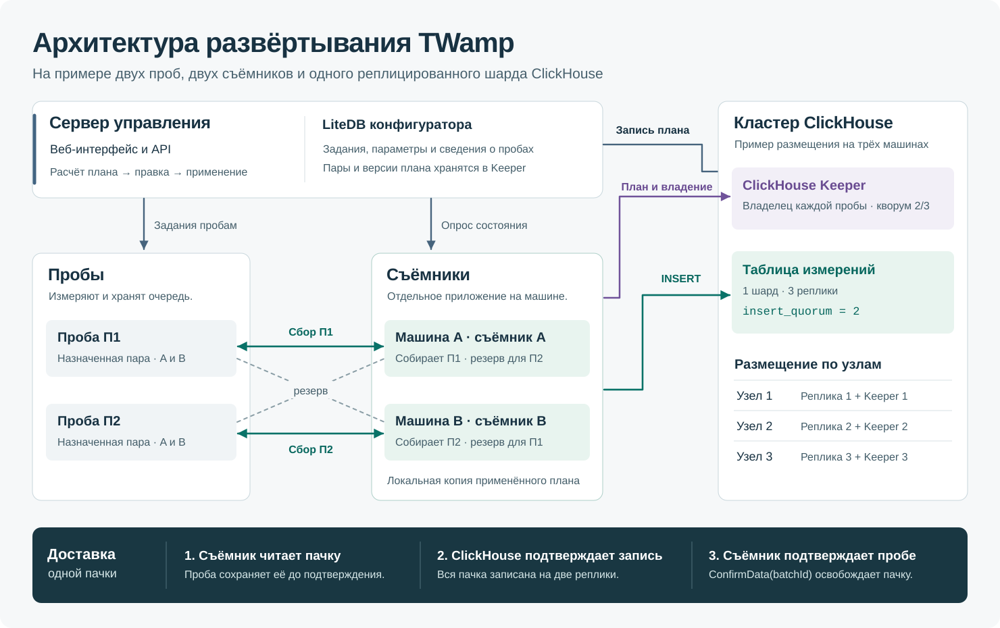

# Развёртывание TWamp с парными съёмниками



Один конфигуратор обслуживает интерфейс, задания и LiteDB. Применённые пары, ручные назначения и версия плана хранятся в Keeper. Съёмник сохраняет локальную копию плана в своём spool. Перед началом работы он сверяет её с Keeper. Конфигуратор может быть выключен, пока съёмники продолжают работу. Потеря большинства Keeper приостанавливает сбор. У каждой пробы своя очередь results.db.

## Кластер

Подготовьте три независимых Linux-машины в закрытой сети с Docker Compose. Положите `compose.yaml` и `clickhouse.xml` в один каталог на каждой. Один экземпляр Compose запускает одну реплику и один Keeper. Имена в примере замените адресами, доступными всем трём машинам. Для каждого узла задайте отдельные CH_NODE_ID, CH_REPLICA и CH_HOST. Идентификатор, имя реплики и том данных сохраняйте при перезапусках.

```dotenv
CH_NODE_ID=1
CH_REPLICA=ch1
CH_HOST=ch1.internal
CH_HOST_1=ch1.internal
CH_HOST_2=ch2.internal
CH_HOST_3=ch3.internal
CLICKHOUSE_PASSWORD=<пароль пользователя ClickHouse>
```

Сохраните эти значения в локальном `.env` с доступом только администратора. Запустите `docker compose up -d` на каждой машине. Для уже установленного ClickHouse эти же секции XML можно добавить в config.d с подстановкой значений. При использовании существующего Keeper используйте его ensemble. Съёмникам нужен HTTP ClickHouse (8123) и Keeper (9181), конфигуратору нужен Keeper. Между узлами кластера требуются 9234 для Raft и 9009 для передачи частей. Порт 9000 служит для native-клиентов ClickHouse. Ограничьте доступ к этим портам сетью развёртывания. Каталог /var/lib/clickhouse должен находиться на постоянном диске. При потере этого диска восстанавливайте узел как реплику.

## Настройки приложений

На конфигураторе и на каждом съёмнике задайте общий раздел в appsettings.json. Обязательный секрет Digest задайте через переменную окружения HighAvailability__Digest в формате логин:пароль. Все службы должны видеть один ensemble и одно пространство. Настройте также общий Auth:ApiKey для HTTP API конфигуратора, съёмников и проб.

```json
{
  "HighAvailability": {
    "Enabled": true,
    "Keeper": "ch1.internal:9181,ch2.internal:9181,ch3.internal:9181",
    "Root": "/twamp-ha",
    "Target": "twamp.results_ha",
    "SessionTimeoutMs": 15000,
    "StandbyDelaySeconds": 6
  }
}
```

Каждому съёмнику назначьте уникальный Collector:Id и постоянное имя физической машины Collector:Machine. По умолчанию используется имя хоста ОС. В контейнере задавайте физическую машину явно. Укажите собственный каталог spool, доступный адрес службы и три HTTP-адреса одного шарда. Пример дополнительных настроек съёмника A:

```json
{
  "Urls": "http://0.0.0.0:9001",
  "Collector": { "Id": "a", "Machine": "srv-a" },
  "Configurator": { "Url": "http://manager.internal:9000" },
  "ClickHouse": {
    "Enabled": true,
    "Urls": ["http://ch1.internal:8123","http://ch2.internal:8123","http://ch3.internal:8123"],
    "Database": "twamp",
    "Table": "results_ha",
    "SpoolPath": "/var/lib/twamp-collector/spool"
  }
}
```

Передайте ClickHouse__User и ClickHouse__Password учётной записи, которой разрешены создание базы и таблицы, ALTER, INSERT и чтение system.replicas. Съёмник создаёт ReplicatedReplacingMergeTree на доступных узлах и выполняет синхронный INSERT с insert_quorum=2. Для проб этой версии включите Probe:RequireQuorumAck. Такой экземпляр отклоняет подтверждение от старого одиночного съёмника. Старые версии проб поддерживают протокол парного съёма после остановки всех прежних владельцев. Длительность автономных измерений также зависит от свободного места и Probe:ServerTimeoutHours.

## Реестр и переключение

1. Откройте **Реестр и балансировка**, укажите адреса съёмников и нажмите **Добавить съёмник**. Сервис сверит ID, машину, целевую таблицу и фактический идентификатор Keeper. Чтобы обновить адрес существующего съёмника, добавьте его новый адрес с тем же ID.
2. Добавьте пробу по адресу. Выберите два съёмника на разных машинах и проверьте обе связи. Один экземпляр может входить в несколько пар. Для горячего резерва задайте съёмнику соответствующий режим. Для ручной привязки основного выберите его в строке пробы.
3. Нажмите **Рассчитать план**. Для занятой пробы вес учитывает результаты в секунду, объём данных и время разбора. Для новой используются задания, повторы и частота расписания. Производительность съёмника задаётся в тех же относительных единицах, её подбирают по устойчивой измеренной нагрузке. Предпросмотр показывает загрузку и прогноз при отказе одной машины.
4. **Применить просмотренный план** публикует всю конфигурацию одной версионной операцией. При одновременной правке перечитайте реестр. Для удаления занятого съёмника сначала выберите замены для всех его проб в черновике. Удаление пробы снимает её с обоих съёмников. Реестр заданий конфигуратор обслуживает по прежней процедуре снятия пробы.
5. Keeper выдаёт временное владение отдельно для каждой пробы. Если основной процесс погибает, резерв подхватывает пробу после истечения сессии. При ошибке доступа к одной пробе владелец освобождает её и делает паузу. После восстановления основной автоматически не вытесняет работающий резерв. Для возврата нагрузки пересчитайте и примените план.

## Обновление существующей установки

По умолчанию HighAvailability:Enabled выключен. Обновление пакетов сохраняет действующую одиночную схему до явного перехода. Сохраните резервные копии LiteDB, spool, состояния проб и ClickHouse. Доведите старый spool до пустой очереди и остановите **все** процессы, которые могли получать CheckData и отправлять ConfirmData. Учтите машины с временно потерянной связью. Если старые данные в spool уже подтверждены пробам, сохраните их и завершите прежнюю выгрузку до переключения.

На первом узле с прежними данными оставьте старую таблицу. Для HA задайте новое имя, например twamp.results_ha. Запустите конфигуратор и съёмники с одинаковыми HA-настройками. Прежние пробы отображаются среди адресов для добавления. Для каждой выберите проверенную пару и примените план. Старыми API можно продолжать читать состояние. Одиночный протокол каталога в режиме HA отдаёт пустой список. Съёмник отказывается подтверждать пачку через прежнюю таблицу ReplacingMergeTree. Сохранённая одиночная отметка stored перед подтверждением в HA требует повторной кворумной записи.

Для переноса истории выполняйте INSERT SELECT на узле, где доступны обе таблицы. Остановите старых писателей, работайте по месячным партициям и перечисляйте столбцы по именам в одинаковом порядке для INSERT и SELECT. Возьмите имена из system.columns старой таблицы (position), проверьте их наличие и типы в новой. Используйте FROM twamp.results FINAL, insert_quorum=2 и постоянный insert_deduplication_token для каждого неизменного диапазона. Перед переводом исторических отчётов сверьте по месяцам число уникальных пар (ResultId, RowNo), время и агрегаты на двух репликах; храните старую таблицу до окончания сверки. Для новых строк Started записывается в UTC. Для точных отчётов по повторной доставке используйте FINAL либо группировку по ключу строки: срок журнала блочной дедупликации ClickHouse ограничен.

Для отката остановите HA-съёмники, сохраните их spool и очередь проб, завершите или учтите все неподтверждённые доставки. Переключите отчёты и назначения на прежнюю таблицу и снимите требование кворумного ACK на возвращаемых пробах перед запуском одиночного съёмника. Для повторного включения HA сохраните пространство Keeper и его учётные данные.
