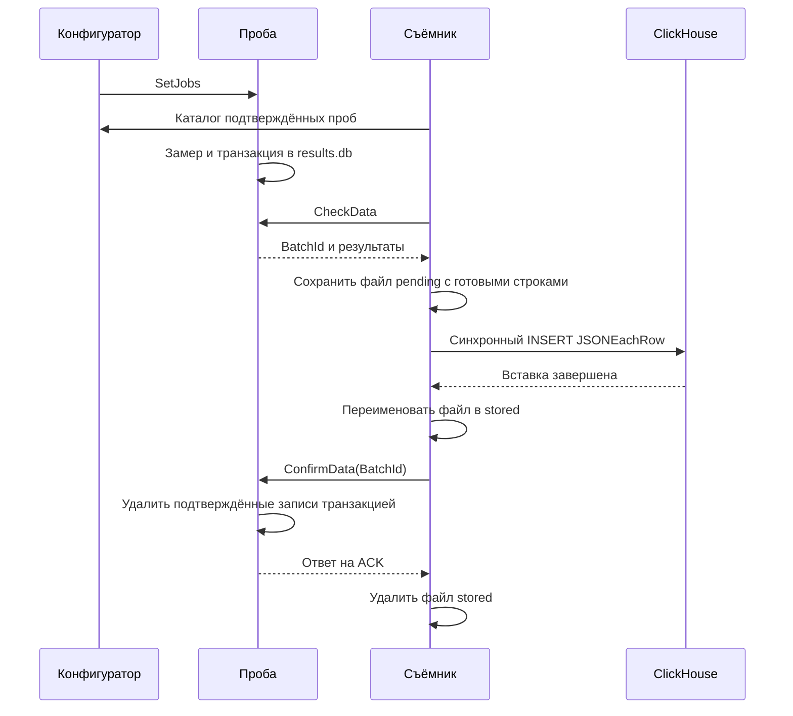
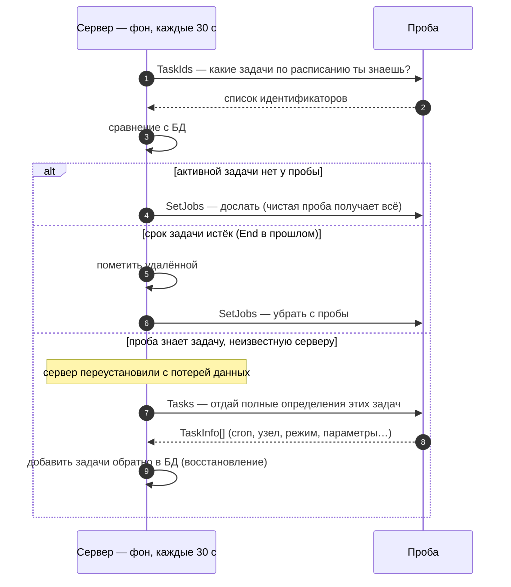
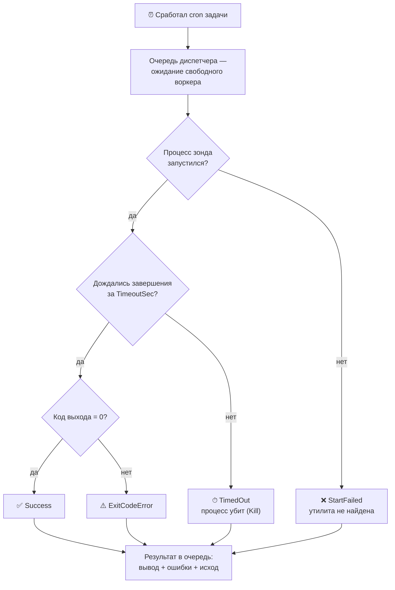
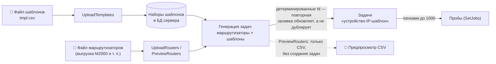
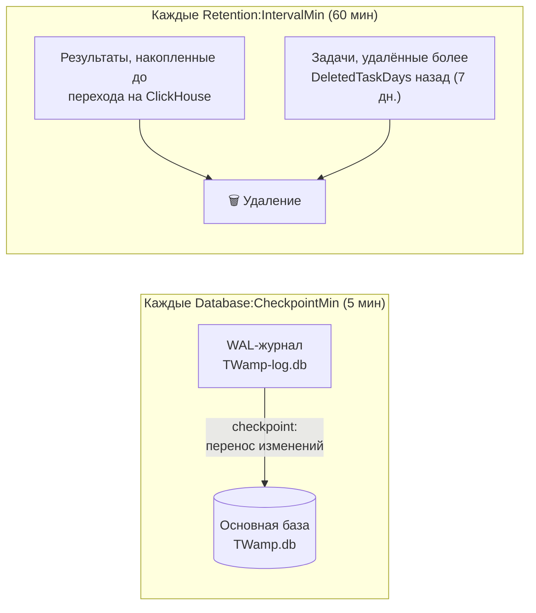
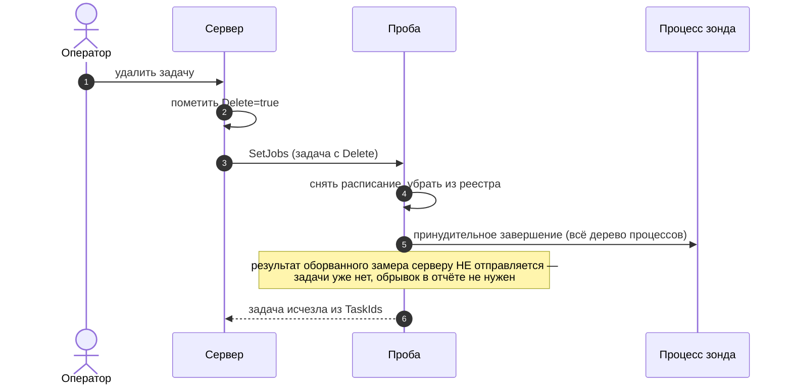

[← К обзору проекта (README)](../README.md) · [Вся документация](README.md)

---

## Архитектура

| Служба | Что делает | Состояние на диске |
|---|---|---|
| Конфигуратор · ASP.NET Core · порт 9000 | Веб-интерфейс, регистрация проб, задачи и сверка расписаний | LiteDB с пробами, задачами и шаблонами |
| Съёмник · ASP.NET Core · порт 9001 | Получает каталог у конфигуратора, опрашивает пробы и пишет в ClickHouse | По одной неподтверждённой пачке на пробу в `spool/delivery` |
| Проба · Go · порт 8443 | Исполняет измерения TWamp, TWampy и ping | Расписание в `TaskInfo.json` и очередь результатов в `results.db` |

### Путь результатов в ClickHouse

Пока ClickHouse недоступен, у съёмника остаётся файл `pending`, а на пробе сохраняется вся очередь. Если вставка завершилась, но её ответ потерялся, съёмник повторяет вставку тех же строк. Таблица `ReplacingMergeTree` объединяет повторы по `(Started, ResultId, RowNo)`. Для чтения без ещё не объединённых повторов используется `FINAL`. Если потерялся ответ пробы на ACK, съёмник повторяет только подтверждение. Пустой или неизвестный формат вывода образует одну строку с исходным текстом и исходом запуска.

Проба ограничивает размер выдаваемой пачки через `Probe:ResultBatchSize`. Остальные замеры ждут на диске. При ошибке записи на диск исполнитель удерживает полученный результат и повторяет запись. Для длительных отказов хранилища нужно свободное место на обеих сторонах.

### Подключение новой пробы

Оператор указывает адрес пробы на вкладке «Статус проб» и подтверждает её. Конфигуратор сверяет расписание. Съёмник получает список подтверждённых проб через `GET /api/collector/catalog`. При перезапуске он сначала находит сохранённые пачки на диске и может доставить их даже при недоступном конфигураторе.

### Фоновая сверка задач (самовосстановление)

Каждые `Probe:ReconcileIntervalSec` (по умолчанию 30 с) сервер выравнивает список
задач каждой пробы со своей БД. Благодаря этому чистая переустановленная проба
конфигурируется сама, а устаревшие задачи не «зависают».

> **Восстановление после потери данных.** Если сервер переустановили и его БД
> пуста, все задачи пробы становятся «сиротами». Сервер не удаляет их, а
> **забирает с пробы полные определения** (эндпоинт `Tasks`) и добавляет обратно
> в свою БД — так живая проба «возвращает» серверу его задачи. Удалённые задачи
> при этом не воскресают: реальные удаления хранятся на сервере как «надгробия»
> (`Delete=true`) до истечения ретенции, поэтому сиротой считается лишь задача,
> о которой у сервера нет вообще никаких записей.

### Выполнение зонда на пробе: исходы запуска

Каждый запуск заканчивается одним из четырёх исходов — он виден в статусе задач
и попадает в отчёт (колонка `Errors` собирает stderr, таймаут и код выхода).

### Массовая заливка: шаблоны × маршрутизаторы

Тысячи задач создаются одним запросом: набор шаблонов накладывается на выгрузку
маршрутизаторов из системы инвентаризации.

---
## Механизмы надёжности

### Инкрементальная синхронизация задач

Схема сверки — [выше](#фоновая-сверка-задач-самовосстановление). Словами:

- Изменения передаются пробе адресно: одна задача — один элемент в `SetJobs`; массовая заливка — пачками до 1000.
- Проба сливает изменения в свой реестр (добавить/обновить/удалить) и хранит его в `TaskInfo.json`.
- Фоновая сверка каждые `ReconcileIntervalSec`: сервер сравнивает `TaskIds` пробы со своей БД, **досылает недостающее** (чистая переустановленная проба конфигурируется сама), **удаляет** с пробы устаревшие (`End` в прошлом).
- **Восстановление сервера**: задачи, которые есть на пробе, но которых нет в БД сервера (после его переустановки с потерей данных), сервер **забирает с пробы и добавляет к себе** (а не удаляет) — см. врезку выше.

### Ретенция и обслуживание LiteDB

Два фоновых процесса не дают базе расти бесконечно:

> Новые результаты в базу сервера **не пишутся вовсе** — они уходят в ClickHouse
> (см. [путь результатов](#путь-результатов-в-clickhouse)). Ключи `Retention:RawDays`
> и `Retention:StatsDays` продолжают вычищать данные, накопленные прежними версиями.

WAL-журнал (`*-log.db`) в первую очередь ограничивает **встроенный авто-checkpoint LiteDB**
(по порогу в страницах журнала, срабатывает на пути записи). Периодический checkpoint из
обслуживания — лишь подстраховка: под интенсивной записью он не всегда успевает взять
эксклюзивную блокировку и тогда пропускается с кратким предупреждением (не ошибкой),
не влияя на работу — журнал всё равно сводит авто-checkpoint.

### Отмена задачи обрывает выполнение немедленно

Удаление задачи на сервере не ждёт конца текущего замера: проба **убивает процесс зонда**
прямо в работе. Иначе `twping -c 300 -i 1` домерял бы ещё несколько минут по задаче,
которой уже нет, занимая воркер и сетевые ресурсы.

Работает для любых задач: и по расписанию, и разовых (`Repeater`), которые в реестре
пробы не хранятся вовсе. То же происходит, когда проба считает себя удалённой по
сторожу связи (`Probe:ServerTimeoutHours`) — обрываются все активные запуски сразу.

Проверено вживую: зонд `ping -n 300` (около 300 секунд работы) после удаления задачи
на сервере был убит **за 1 секунду**, обрывок замера в отчёт не попал.

### Удаление пробы и потеря связи

Конфигуратор снимает расписание удалённой пробы. Сторож на пробе также может остановить задачи после `Probe:ServerTimeoutHours` без связи. Уже записанные измерения остаются до подтверждения съёмником. Перед окончательным выводом площадки дождитесь пустой очереди пробы и подтверждения всех пачек в разделе «Хранилище». Съёмник заканчивает доставку уже полученной пачки даже после удаления адреса из каталога.

### Таймаут задачи

`TimeoutSec` задаётся на задачу. Проба ждёт процесс зонда указанное время, затем принудительно завершает всё дерево процессов; частичный вывод и пометка «прервано по таймауту» попадают в результат.

### Отмена задачи

Удаление задачи на сервере обрывает её замеры немедленно: процесс зонда убивается вместе с деревом, встроенный зонд прерывается по контексту. Результат по удалённой задаче серверу **не отправляется** — иначе в отчёте появился бы обрывок замера по задаче, которой уже нет.

Отмена, пришедшая в момент между регистрацией запуска и стартом процесса, обрабатывается так же. Такой запуск падает с ошибкой запуска («context canceled»), и раньше он оформлялся как поломка зонда: по удалённой задаче уходил выдуманный результат «зонд не запустился», а в журнал — `ERROR`. Окно микросекундное, но при тысячах замеров в него попадают регулярно.

### Что попадает в журнал по итогу замера

Итог пишется **один раз на замер**, когда он окончателен. Внутренние повторы (замер, начатый заново из-за занятого порта) в журнал как провалы не идут — иначе одна задача выглядела бы упавшей до десяти раз подряд, хотя в итоге выполнилась. Промежуточные попытки видны отдельными строками про карантин порта, см. [parallelism.md](parallelism.md#как-проба-выбирает-локальные-порты).

Поле `код` пишется только для внешнего зонда: у встроенного процесса нет, и строка вида «исход=ExitCodeError код=0» противоречила бы сама себе. В результате, который уходит серверу, поле остаётся нулевым — его формат не менялся.

---

---

[← К обзору проекта (README)](../README.md) · [Вся документация](README.md)

---
