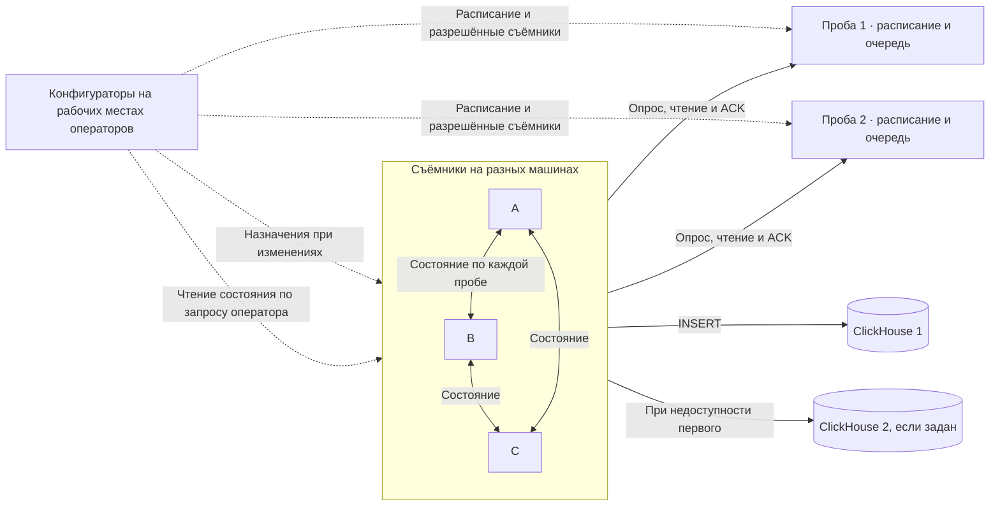

# Автономный сбор с основным съёмником и двумя резервными

Конфигуратор нужен для регистрации, изменения назначений и отправки задач. После подтверждения настроек его можно выключить. Съёмники и пробы работают как обычные службы Linux. В этой схеме достаточно одного ClickHouse. HTTP-соединение с пробой всегда открывает конфигуратор при настройке или съёмник при работе.



Стрелки показывают инициатора соединения. Проба возвращает данные в ответ на запрос. Список участников хранится на диске съёмника, разрешённая ревизия назначения — в results.db пробы, расписание — в TaskInfo.json. Вкладка «Хранилище» показывает состояние записи в ClickHouse и размер буфера по данным съёмника. История доступна SQL-запросом к ClickHouse.

| Проба | Основной | Резерв 1 | Резерв 2 |
|---|---|---|---|
| П1 | A | B | C |
| П2 | B | A | C |

## Настройка

1. Установите обновлённые пробу, съёмники и конфигуратор. Задайте общий непустой `Auth:ApiKey`. Оставьте `HighAvailability:Enabled=false` на конфигураторе и съёмниках. Для обычной базы на пробе задайте `Probe:RequireQuorumAck=false`.
2. Назначьте уникальные `Collector:Id`. Разрешите съёмникам обращаться друг к другу по их API (обычно TCP 9001), к пробам (обычно TCP 8443) и в ClickHouse (обычно TCP 8123). Пробы принимают только входящие запросы. На каждой машине съёмника задайте доступный извне адрес прослушивания в верхнем поле `Urls`.
3. В разделе **Статус проб** зарегистрируйте съёмники, опросите и подтвердите пробы. В строке подтверждённой пробы выберите **Основной съёмник**, **Резерв 1**, **Резерв 2**, затем **Сохранить съёмники**. Резервные поля можно оставлять пустыми начиная с конца. Порядок действует для конкретной пробы. Если нужны только A и B, оставьте третий столбец пустым.
4. Дождитесь подтверждения доставки назначения. Отправьте задания и проверьте их на пробе в разделе задач. При изменении состава первоначальную конфигурацию должны принять все выбранные съёмники и проба. Рабочее переключение между уже настроенными участниками выполняется автоматически. Для установки, целиком переведённой на автономные назначения, укажите `Collector:UseLegacyCatalog=false` на каждом съёмнике, чтобы отключить запросы к старому каталогу конфигуратора.

Пример настроек съёмника A. На B укажите `"Id": "b"`, на C — `"Id": "c"`. Список `ClickHouse:Urls` принимает от одного адреса. Для единственного сервера можно также оставить `Urls` пустым и задать `ClickHouse:Url`.

```json
{
  "Urls": "http://0.0.0.0:9001",
  "Collector": { "Id": "a", "UseLegacyCatalog": false },
  "Auth": { "ApiKey": "<общий ключ>" },
  "HighAvailability": { "Enabled": false },
  "ClickHouse": {
    "Urls": ["http://ch-1:8123", "http://ch-2:8123"],
    "Database": "twamp",
    "Table": "results",
    "User": "twamp_writer",
    "Password": "<пароль>",
    "FailoverRetrySeconds": 30
  }
}
```

## Несколько конфигураторов

На новом рабочем месте запустите конфигуратор с тем же `Auth:ApiKey`. Во вкладке **Статус проб → Съёмники** введите сетевой адрес одного настроенного съёмника и нажмите **Открыть конфигурацию со съёмника**. Конфигуратор читает адреса проб, подтверждённый каждой пробой порядок съёмников и действующие расписания. Через найденных съёмников он обходит остальные пробы группы. Для изолированной группы введите один адрес из этой группы. Недоступные участники перечисляются в результате открытия.

После работы с другого компьютера снова откройте группу перед редактированием. Проба проверяет версию назначения и версию расписания при изменении. Если данные устарели, откройте конфигурацию со съёмника, проверьте новые значения и повторите нужную правку. Открытие читает устройства и обновляет локальную копию конфигуратора. Локальные шаблоны и история интерфейса остаются в базе своего рабочего места.

В настройках съёмников и проб адреса рабочих мест не указываются. При новой установке раздел `Configurator` отсутствует. При переходе с прежнего каталога удалите `Configurator:Url` или установите `Collector:UseLegacyCatalog=false` после назначения всех проб.

## Как происходит подмена

Съёмники проверяют связь с пробой и доступность хранилища. Резерв опрашивает старших участников по входному API каждого съёмника. Цикл проверки — 5 секунд. Если основной пропустил три проверки, первый резерв запрашивает токен. Второй резерв сначала выдерживает те же три пропуска основного, затем три пропуска первого резерва. При одновременной потере A и B это ориентировочно 30 секунд. Сетевые тайм-ауты, перезапуск процессов и незавершённая запись влияют на фактическое время.

Подтверждение связи продолжается при пустой очереди. Токен выдаёт проба в ответ на входящий запрос. Активный съёмник продлевает токен, срок действия — 15 секунд по часам самой пробы. Проба допускает чтение и подтверждение только для текущего токена. Если старший съёмник снова готов, младший завершает текущую работу и освобождает токен. Разрыв связи только между съёмниками не даёт резерву подтвердить пачку действующего владельца.

При ошибке записи съёмник пробует следующий адрес ClickHouse. После интервала `FailoverRetrySeconds` он снова пробует адреса с начала списка. Проба удаляет пачку после подтверждённой записи. Для независимых серверов результаты, записанные во время отказа, находятся на принявшем сервере. Копирование истории между серверами настраивается отдельно. При потере ответа на уже выполненный INSERT возможна повторная доставка. Для сверки используйте ключи ResultId и RowNo.

## Обновление действующей установки

Перед переходом дайте прежним съёмникам выгрузить накопленный spool. Сохраните каталоги spool, базу конфигуратора, results.db и TaskInfo.json проб. После применения автономного назначения прежний съёмник без токена больше не сможет подтвердить пачку. Чтобы сохранить работу прежних одиночных назначений на том же съёмнике, оставьте `Collector:UseLegacyCatalog=true` до их переноса. Для сохранения автономности при перезапуске оставляйте файлы состояния на постоянном диске.
